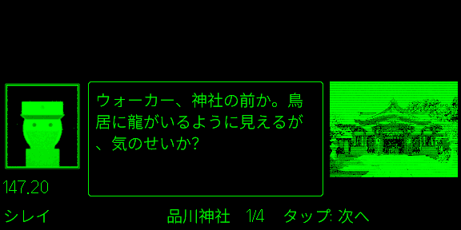

# CODEWALK

[English](README.md)

散歩のおともに「無線」が入るアプリです。いわれのある場所の近くを通ると着信があり、2人のキャラクターがその場所の歴史・文化・雑学を掛け合いで話します。会話は Claude が書き、場所についての事実は出典のあるものだけを使います。

**Even G2**（スマートグラス）の Even Hub アプリとして動き、着信・会話・出典がメガネに出ます。Android アプリもあります。

> **このブランチ（`phone-link`）** では、2つのアプリがつながります。同じスマホで Android アプリが動いていれば、メガネのアプリは単体では動かず、Android アプリの無線を表示します。Even Hub ストアに出す版は `main` ブランチで作ります（メガネのアプリはいつも単体で動きます）。このブランチからストア版のパッケージを作らないでください。

| 待機 | 着信 | 会話 | 出典 |
| --- | --- | --- | --- |
|  |  |  |  |

## 使う前に

- **会話は AI が作っています。** キャラクターが話してよい場所の事実は、出典の付いたものだけです。セリフは1つずつ出典と照らし合わせていますが、それでも誤りが混じることがあります。大事なことは出典を開いて確かめてください。
- **自分の Claude API キーが必要です**（[console.anthropic.com](https://console.anthropic.com/) で発行）。
  - 利用料はそのキーに課金されます。目安は1会話あたり約 $0.02〜0.2 です。
  - 今月の利用額の目安は、アプリの中に出ます。
- **歩くときは周りに気をつけてください。** 会話は応答するまで始まらないので、安全なときに読めます。
- **スマホの外に送るもの:**
  - おおよその現在地（OpenStreetMap・Wikipedia・地図タイルのサーバーへ）
  - 近くの場所の名前と位置（Claude と Photon へ）
  - CODEWALK のサーバーはありません。それ以外はスマホの中に残ります。詳しくは [design.md](design.md) の「外部サービスと送るもの」にあります。
- CODEWALK は個人のプロジェクトです。Even Realities や Anthropic が作ったものではなく、両社とは関係ありません。

## 始め方

### Even G2（メガネ）

メガネのアプリは、ほかのアプリなしで単体で動きます（iPhone・Android とも）。このブランチでは、Android アプリと連携させることもできます（[Android アプリと連携する](g2/README.ja.md#android-アプリと連携する)を参照）。ビルド・インストール・使い方は [g2/README.ja.md](g2/README.ja.md) にあります。

### Android アプリ

[Flutter SDK](https://docs.flutter.dev/get-started/install) が必要です。

```bash
cd app
flutter run              # つないだ端末かエミュレーターで起動
flutter build apk        # 出力先: build/app/outputs/flutter-apk/
flutter test
```

アプリの「設定」で設定する項目:

- **Claude API**: キーを入れて「保存して確認」を押します。キーは Android の Keystore に保存されます。
- **出典を Wikipedia と文化庁に限定する**: 初期値はオフです。
  - オフのときは、自治体・新聞・観光サイトなども使うので、無線が入る場所が増えます。
  - その代わり、口コミ系のサイトが混ざることがあります。
- **連絡先（任意）**: Wikipedia と OpenStreetMap は、アプリに名乗ることを求めています。入れたメールアドレスや URL は User-Agent に入ります。
- **Even G2 に無線を表示する**: 初期値はオンです。その下に出る**ペアリングコード**をメガネのアプリに入れるとつながります（[Android アプリと連携する](g2/README.ja.md#android-アプリと連携する)を参照）。
- **開発モード（位置をシミュレート）**: 地図を長押しした地点を現在地にできます。エミュレーターなら `adb emu geo fix <経度> <緯度>` でも動かせます。

### PC で会話づくりだけ試す

会話づくりの本体は純粋な Dart です。実際の API を呼ぶので、数円〜数十円かかります。

```bash
cd app
ANTHROPIC_API_KEY=sk-ant-... CODEWALK_CONTACT=you@example.com \
  dart run tool/try_dialogue.dart 35.6197 139.7426 history
```

`CODEWALK_ALLOWED_DOMAINS='*'` を付けると、出典のサイトを限定しません。

## 仕組み

1. **場所を探す**
   - 近くの場所は、OpenStreetMap（Overpass）と、位置情報付きの Wikipedia 記事（Wikidata の分類で選別）から集めます。同じ場所はまとめます。
   - 町ごとに Web 検索で「通りかかると面白い場所」も探し、地図で確かめられたものだけを加えます。
2. **会話を作る**（通りそうな場所の分を先に作っておきます）
   - Claude の Web 検索で事実を集めます。引用（出典の原文と URL）の付いた文だけを「事実カード」にします。
   - Claude が会話の型（クイズ、脱線、司令のぼやきなど）を選んで短い雑談を書きます。場所についての事実はカードからだけです。
   - 別の呼び出しでセリフを1つずつ出典と照らし合わせ、裏付けのないセリフは書き直させます。
   - 最後に採点し、合格点に届かなければ1回書き直させます。
   - 事実が2つ未満の場所では、無線を鳴らしません。
3. **着信**
   - 場所から約60m以内に入ると着信します。
   - 10秒応答がなければ「あとで」になります。
   - 会話が終わると出典が出ます。
4. **ほかの無線**
   - 同じ場所は、最後に聞いてから1時間たつとまた鳴ります。会話は新しく作り、できるだけ別のキャラクターが話します。
   - 新しい町に入ると「町の雑学」が入ります。
   - 15分間なにも鳴らなかったら、「今日は何の日」の雑談が入ります（1日1回）。
5. **無線ログ**: 受けた無線は、場所と出典と一緒にスマホに保存されます。
6. **言語**: 日本語と English に対応しています。アプリの画面・会話・キャラクターが、選んだ言語に切り替わります。

モデルは、調査と照合が Claude Haiku、会話と採点が Claude Sonnet です。設定は [claude.dart](app/lib/engine/claude.dart) の `EngineConfig`、指示文は [texts.dart](app/lib/engine/texts.dart) にあります。

## キャラクターの肖像

キャラクターごとに肖像の画像があり、キャラクター名のファイルで両方のアプリに入っています（`app/assets/characters/` と `g2/public/characters/`）。

| ファイル | キャラクター |
| --- | --- |
| `commander.png` | シレイ（聞き役） |
| `owl.png` | フクロウ（歴史） |
| `sphinx.png` | スフィンクス（建築） |
| `dino.png` | キョウリュウ（自然） |
| `fox.png` | キツネ（地名・言葉） |
| `monkey.png` | サル（アニメ・映画・音楽） |
| `seal.png` | アザラシ（ガジェット・テック） |
| `cat.png` | ネコ（酒・食文化） |

このリポジトリには、簡単な見本の肖像が入っています。自分の絵を使うときは、次の手順で1枚ずつ用意してください。

1. 顔の入り方を決めて、絵を約 0.87 : 1 の比率（例: 260 × 300）に切り抜きます。
2. [radio_portrait.py](app/tool/portraits/radio_portrait.py) で変換します。無線の画面風の色合いとノイズ（暗い画面に緑の濃淡、ぼかし、走査線、ざらつき、横ずれ）をかけ、二重の枠を付けて 292 × 332 の肖像にします。Python 3 と Pillow が要ります。

```bash
python3 app/tool/portraits/radio_portrait.py my_owl.png --character owl --install
```

- `--install` を付けると、両方のアプリに書き込みます。付けないときは `./owl.png`（`--out` で指定した場所）に書き出します。
- `--preview owl_glasses.png` を付けると、メガネでのおおよその見え方も書き出します。メガネでは濃淡だけになり、暗いほうの40%は黒（光らない）になります。
- 絵の端につながった白い背景と、透明な背景は、暗い画面になります。輪郭の内側の白はそのまま残ります。背景を残したいときは `--keep-background` を付けます。
- 比率が違う絵は、中央で切り抜きます（そのことを表示します）。

使う絵は、このように使って配ってよいものだけにしてください。見本を描き直すときは [sample_portraits.py](app/tool/portraits/sample_portraits.py) を実行します。

## ファイルの構成

```
app/             Android アプリ（Flutter）。両方のアプリが使う会話づくりの本体もここにある
app/lib/engine/  会話づくりの本体（純粋な Dart。PC でも動く）
g2/              Even G2 のアプリ（Even Hub、TypeScript）。会話づくりの本体を JavaScript にして使う
design.md        構成と設計の資料
```

## 既知の制約

- OpenStreetMap の Overpass API は混みやすく、答えるまで40〜50秒かかったり、失敗したりします。そのときは次のように動きます。
  - 待ってから、ほかのサーバーを試す
  - 前に取れた結果（1年以内）か、Wikipedia の場所だけで続ける
  - 少しあとで取り直す
- Android アプリの地図は、OpenStreetMap の公開タイルを使っています。試作には問題ありませんが、広く配るときは、利用規約が合うタイルの提供元に切り替える必要があります。
- 会話のキャッシュはスマホごとです。そのため、会話を作る費用は利用者それぞれにかかります。
- 1本の会話を作るのに、20〜70秒ほど通信します。途中でアプリを終了すると、次に起動したときに作り直します。

## クレジット

- 地図データ © [OpenStreetMap](https://www.openstreetmap.org/copyright) contributors、© [OpenMapTiles](https://openmaptiles.org/)
- ミニマップのタイル: [OpenFreeMap](https://openfreemap.org/)
- 場所の写真: Wikimedia Commons（作者とライセンスはアプリ内に表示）
- Even Hub ストア版のキャラクターの肖像は、[いらすとや](https://www.irasutoya.com/)のイラストをもとにしています。このリポジトリには入っていません。

## ライセンス

[Apache License 2.0](LICENSE)
