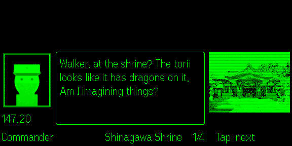

# CODEWALK

[日本語](README.ja.md)

A walking companion that talks to you over the "radio". When you pass near a place with a story, a call comes in, and two characters chat about that place's history, culture and trivia. Claude writes the conversations, and facts about the place come only from cited sources.

It runs on **Even G2** smart glasses as an Even Hub app (calls, conversations and sources show on the glasses). There is also an Android app.

| Waiting | Incoming call | Conversation | Sources |
| --- | --- | --- | --- |
|  |  |  |  |

## Before you use it

- **The conversations are AI-generated.** The characters may only state facts about a place that come with a citation, and each line is checked against its source, but mistakes can still slip through. If something matters to you, follow the source links.
- **You need your own Claude API key** ([console.anthropic.com](https://console.anthropic.com/)). Usage is billed to your key, roughly $0.02–0.2 per conversation. The app shows an estimate of this month's spend.
- **Watch where you walk.** A call starts only when you answer it, so you can read it when it is safe.
- **What leaves your phone:**
  - your approximate location (to OpenStreetMap, Wikipedia and the map tile server)
  - the names and locations of nearby places (to Claude and Photon)
  - Nothing goes to a CODEWALK server, because there isn't one. Details are in section 8 of [design.md](design.md) (Japanese).
- CODEWALK is an independent project. It is not made by or affiliated with Even Realities or Anthropic.

## Getting started

### Even G2 (glasses)

The glasses app runs on its own, with no other app needed, on iPhone or Android. See [g2/README.md](g2/README.md) to build, install and use it.

### Android app

You need the [Flutter SDK](https://docs.flutter.dev/get-started/install).

```bash
cd app
flutter run              # on a connected device or emulator
flutter build apk        # output: build/app/outputs/flutter-apk/
flutter test
```

In the app's Settings:

- **Claude API**: enter your key and tap "Save and check". The key is stored in the Android Keystore.
- **Only use Wikipedia and the Agency for Cultural Affairs**: off by default. With it off, city, news and travel sites are used too, so more places get calls, but some of those sources are less reliable.
- **Contact (optional)**: Wikipedia and OpenStreetMap ask apps to identify themselves. Your email or URL goes into the User-Agent.
- **Dev mode (simulate location)**: long-press the map to set your position. On an emulator, `adb emu geo fix <lon> <lat>` also works.

### Try the conversation engine from a PC

The engine is plain Dart. This makes real API calls, which cost a few cents.

```bash
cd app
ANTHROPIC_API_KEY=sk-ant-... CODEWALK_CONTACT=you@example.com \
  dart run tool/try_dialogue.dart 35.6197 139.7426 history
```

Add `CODEWALK_ALLOWED_DOMAINS='*'` to allow any source site.

## How it works

1. **Finding places.** Nearby places come from OpenStreetMap (Overpass) and geotagged Wikipedia articles, filtered by their Wikidata class. Duplicates are merged. For each town, a web search also looks for places worth passing by, and they are kept only if the map confirms them.
2. **Writing conversations.** They are prepared ahead of time for the places you are likely to pass:
   - Claude's web search collects facts. Only sentences backed by a citation (quoted source text and its URL) become "fact cards".
   - Claude writes a short chat in one of several styles (a quiz, a digression, the commander grumbling, and so on). Facts about the place may come only from the cards.
   - A separate call checks each line against its source and rewrites unsupported lines. A review then scores the result and asks for one rewrite if it falls short.
   - A place with fewer than two facts never calls.
3. **The call.** About 60 m from a place, a call comes in. If you don't answer within 10 seconds, it is saved for later. The sources are listed after the conversation.
4. **More calls.**
   - A place can call again an hour after you last heard it, with a new conversation and, when possible, another character.
   - Entering a new town brings some town trivia.
   - After 15 quiet minutes, an "on this day" chat comes in (once a day).
5. **Call log.** Every call is kept on your phone, with its place and its sources.
6. **Languages.** Japanese and English. The app, the conversations and the characters follow the chosen language.

Claude Haiku does the research and the checks; Claude Sonnet writes and reviews. See `EngineConfig` in [claude.dart](app/lib/engine/claude.dart) and the prompts in [texts.dart](app/lib/engine/texts.dart).

## Character portraits

Each character has a portrait, named after the character, in both apps: `app/assets/characters/` and `g2/public/characters/`.

| File | Character |
| --- | --- |
| `commander.png` | Commander (asks the questions) |
| `owl.png` | Owl (history) |
| `sphinx.png` | Sphinx (architecture) |
| `dino.png` | Dino (nature) |
| `fox.png` | Fox (place names) |
| `monkey.png` | Monkey (anime, film, music) |
| `seal.png` | Seal (gadgets, tech) |
| `cat.png` | Cat (food, sake) |

This repository ships simple sample portraits. To use your own pictures:

1. Crop each picture the way you want the face framed, at about 0.87 : 1 (for example 260 × 300).
2. Convert it with [radio_portrait.py](app/tool/portraits/radio_portrait.py). It gives the picture the radio screen look (green on a dark screen, soft edges, scanlines, grain, a couple of glitches) and adds the double frame, making a 292 × 332 portrait. You need Python 3 and Pillow.

```bash
python3 app/tool/portraits/radio_portrait.py my_owl.png --character owl --install
```

- `--install` writes the portrait into both apps. Without it, the portrait is written to `./owl.png`, or to the path given with `--out`.
- `--preview owl_glasses.png` also writes a rough preview of how the glasses show it. The glasses turn the portrait into greys and black out its darkest 40%.
- A white background that touches the edges of the picture becomes the dark screen, and so does a transparent one. White inside the outline stays. Use `--keep-background` to keep the background.
- A picture whose proportions differ is centre-cropped (with a note).

Use only pictures that you may use and distribute this way. To draw the samples again, run [sample_portraits.py](app/tool/portraits/sample_portraits.py).

## Repository layout

```
app/             Android app (Flutter); also holds the conversation engine both apps use
app/lib/engine/  The conversation engine (plain Dart; runs on a PC too)
g2/              The Even G2 app (Even Hub, TypeScript); runs the engine compiled to JavaScript
design.md        Architecture and design notes (Japanese)
```

## Known limitations

- The OpenStreetMap Overpass API is often busy, and can take 40–50 seconds to answer or fail. When that happens, CODEWALK:
  - waits, then tries other servers
  - falls back to earlier results (up to a year old), or to Wikipedia places alone
  - tries again later
- The Android app's map uses the public OpenStreetMap tiles. That is fine for a prototype, but a wider release should switch to a tile provider whose terms allow it.
- Conversations are cached on each phone, so each user pays for their own.
- Writing one conversation takes 20–70 seconds of network use. If the app is closed in the middle, the conversation is written again next time.

## Credits

- Map data © [OpenStreetMap](https://www.openstreetmap.org/copyright) contributors, © [OpenMapTiles](https://openmaptiles.org/)
- Minimap tiles from [OpenFreeMap](https://openfreemap.org/)
- Place photos from Wikimedia Commons, with their author and license shown in the app
- The character portraits of the Even Hub store build are based on illustrations by [いらすとや](https://www.irasutoya.com/). They are not included in this repository.

## License

[Apache License 2.0](LICENSE)
