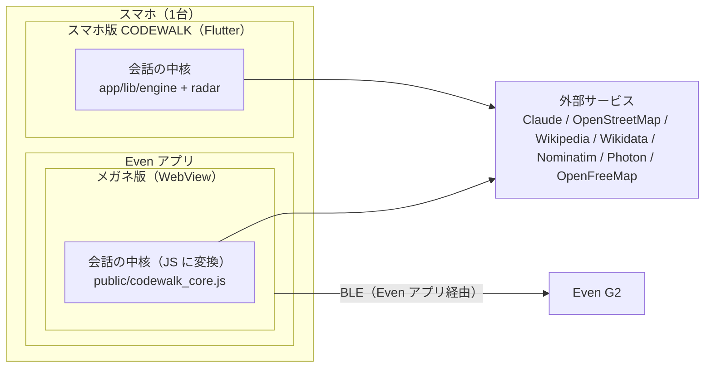
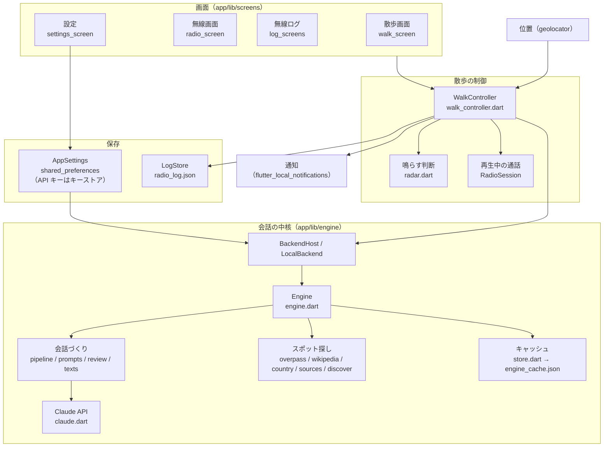
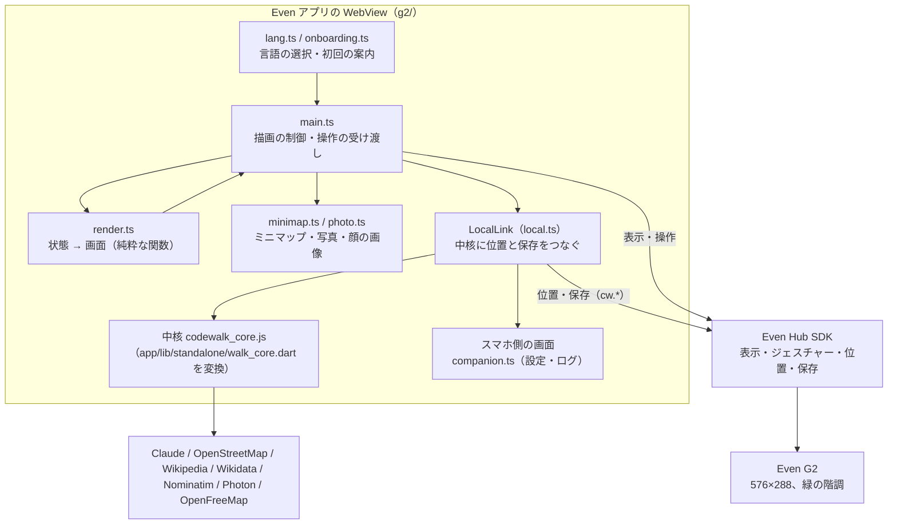
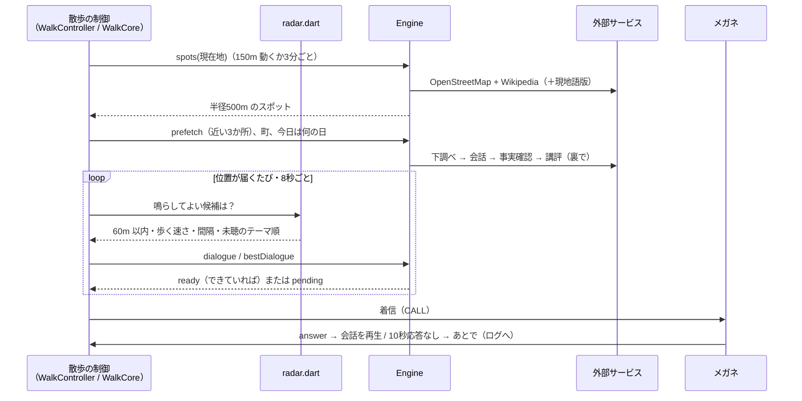
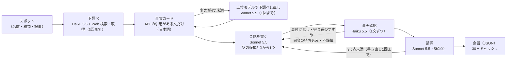

# CODEWALK 設計資料

散歩中、近くの場所について「司令」と専門担当が無線で掛け合う会話を、AI（Claude）で作って届けるアプリの構成と仕組みをまとめた資料です。使い方や遊び方は [README.md](README.md) を見てください。

## 1. 全体像

アプリは2つあり、どちらも自前のサーバーを持ちません。会話は、利用者自身の Claude API キーで端末から直接作ります。

| アプリ | 場所 | 技術 | 役割 |
| --- | --- | --- | --- |
| スマホ版 | `app/` | Flutter（Android） | 位置の取得、スポット探し、会話づくり、無線ログ、設定（スマホの画面だけで使う） |
| メガネ版 | `g2/` | TypeScript（Even Hub アプリ。Even アプリの WebView で動く） | Even G2 への表示と操作。会話づくりまでこのアプリの中で行う（Even Hub ストア版） |

2つのアプリはつながりません。メガネ版はいつも単体で動きます。

会話を作る中核（`app/lib/engine/` と散歩の判断 `app/lib/radar.dart`）は Dart で書かれていて、スマホ版はそのまま、メガネ版は JavaScript に変換して使います。どちらで動いても、同じ場所では同じ考え方で無線が鳴ります。

その他のディレクトリ:

| 場所 | 中身 |
| --- | --- |
| `app/tool/` | 開発用の道具（実 API で会話を試す、アイコン生成） |

## 2. スマホ版のアーキテクチャ

- **WalkController** が散歩の中心です。位置が届くたびと8秒ごとに `_evaluate` を回し、スポットの取り直し、鳴らす候補の選定、会話の依頼、着信を行います。
- **radar.dart** は Flutter に依存しない判断だけを持ちます（どのスポットを、いつ鳴らすか）。テストしやすくするためと、メガネ版でも同じ判断を使うためです。
- 画面を消していても位置を取り続けるため、Android の常駐通知（フォアグラウンドサービス）を使います。

## 3. メガネ版のアーキテクチャ

### 3.1 起動と設定

- 状態は、アプリ内の中核（`codewalk_core.js`）から LocalLink が受け取ります。設定と無線ログは、Even アプリで開くスマホ側の画面（`companion.ts`、「散歩」「無線ログ」「設定」の3つのタブ）にあります。無線ログはスマホ版と同じ「今日 / 今週 / すべて」で絞り込みます（中核の `LogRange`）。
- 言語は、スマホ側の画面の一番上で選びます（`lang.ts`）。
- 初回の起動では、何かを始める前に、言語（日英併記）→ はじめる前の案内（API キーと、画面を消して歩くときの設定）の順で出します（`onboarding.ts`）。
- 状態の形は `WalkState`（`render.ts`）で、`render.ts` はこれだけを見て画面を決めます。

### 3.2 中核

`app/lib/standalone/walk_core.dart` は、スマホ版の WalkController と同じ流れを Flutter なしで書いたものです。`js_main.dart` が `globalThis.createCodewalkCore(host, storeJson, logJson, settingsJson)` を JavaScript に公開し、`g2/scripts/build_core.mjs` が `dart compile js` で `g2/public/codewalk_core.js` を作ります（約430KB）。

| 中核が使うもの | 中身 |
| --- | --- |
| 位置 | Even Hub SDK の位置取得。連続取得（`startAppLocationUpdates`）は開始直後の1回しか届かないため、5秒ごとに `getAppLocation` で聞く。画面オフ中も取るには、Even アプリの「バックグラウンドタスク」で「常時表示の通知」をオンにする必要がある |
| 保存 | Even Hub SDK の保存（`cw.settings` / `cw.store` / `cw.log` / `cw.spend` / `cw.lang`） |
| 外部への通信 | WebView の fetch。`app.json` の通信許可リストに全ホストを書く |
| キャラクター画像 | `g2/public/characters/` にキャラクター名のファイルで同梱（グレースケールに縮小）。作り方は README の「キャラクターの肖像」 |

ブラウザから外部サービスを呼ぶため、ブラウザで動くときだけ次を付けます（`app/lib/engine/util.dart` の `isWeb`）: Wikimedia には `origin=*` と `Api-User-Agent`、Claude には `anthropic-dangerous-direct-browser-access`。Nominatim には、User-Agent の代わりに `email=` で名乗ります（`util.dart` の `appContactEmail`。空なら利用者が設定した連絡先のメールアドレス）。

### 3.3 メガネの画面

画面は5種類で、`render(state)` が決めます。

| 画面 | いつ | 中身 | 操作 |
| --- | --- | --- | --- |
| offline | 状態がない | 準備中の案内（初回は言語選びの案内） | ダブルタップで終了 |
| idle | 待機中 | 状態の一文、ミニマップ、歩いた距離 | — |
| incoming | 着信 | CALL（10秒間点滅）、司令の顔、周波数、スポット名 | タップ: 応答、スワイプ: あとで |
| call | 会話中 | 前のセリフ（暗め）、顔＋周波数、いまのセリフの枠、写真、名前、進み具合 | タップ: 次へ、スワイプ: 戻る |
| sources | 会話の最後 | 出典と写真のクレジット | タップ: 終える |

同じ容器の組み合わせのままならテキストだけ差し替え、組み合わせが変わったときだけ画面を作り直します（ちらつきと通信を減らすため）。画像の送信は1枚ずつ順番に行います。

## 4. 無線が鳴るまで

鳴らす判断（`radar.dart`）の主な決まり:

| 決まり | 値 |
| --- | --- |
| 鳴る距離 | スポットから60m 以内 |
| 先に作る範囲と数 | 300m 以内の近い3か所 |
| スポットを取り直す | 150m 動いたか、3分たったとき |
| 無線の間隔 | 頻度の設定で 2 / 5 / 15 分以上あける |
| 速すぎるときは鳴らさない | 秒速4m（時速約14km）を超えたら（自転車・車） |
| 同じ場所がまた鳴る | 1時間たったら。2回目以降は別の会話（別の担当を優先） |
| 近くに話題がないとき | 町の会話。それもなければ、散歩開始から15分で「今日は何の日」 |
| テーマの順番 | 直近7日で聞いた回数が少ないテーマから |
| 自動の「あとで」 | 着信から10秒応答がなければログへ |

## 5. 会話の作り方

- **事実カード**: Claude の Web 検索・取得が付けた引用（出典の原文と URL）がある文だけをカードにします。情報源は何語でもよく（海外では現地語版 Wikipedia など）、カードは日本語で書きます。会話が英語のときは、カードを英語に直しながら書きます。
- **事実の決まり**: この場所についての具体的な事実はカードからだけ。司令は事実を持ち込まず、驚き・推測・ぼやき・脱線で回します。
- **会話の型**: 9種類から3つを候補に出し、カードに合う1つを選ばせます。謎かけ（quiz）はスフィンクスだけで、4回に1回くらいしか候補に出ません。
- **悲しい出来事**: 災害・戦争・事故などは静かに扱います。事実確認で「不謹慎」と判定されたセリフは必ず削り、書き直させます。
- **費用**: 1本あたり実測0.03〜0.17ドル（多くは0.03〜0.05ドル）。最悪の場合（下調べ2回、下書き4つ）でも0.3〜0.4ドルが目安です。

キャッシュの単位は「場所 × テーマ × 回数 × 言語」です（例: `osm:node:1|history|r1|en`）。名前を変える前に作られた会話は、使わずに作り直します。

## 6. スポットの集め方

| 情報源 | 何が分かる | 備考 |
| --- | --- | --- |
| OpenStreetMap（Overpass） | 寺社・史跡・橋・駅・記念碑など、地図に載っているもの | 日本ではスポットの大半。混雑で40〜50秒かかることがあるので、1サーバー75秒・合計150秒まで待つ。予備は overpass.private.coffee（ストア版では、利用者の位置を送る先を増やさないため maps.mail.ru は使わない） |
| Wikipedia（位置情報付きの記事） | 記事のある場所。Wikidata の分類でテーマを決める | 日本語版はどこでも。海外では現地語版も（国は Nominatim で判定し、1度四方ごとに1年保存。失敗したらその起動中は聞かず、日本の範囲かどうかで決める） |
| Claude の追加探し | 町の中の「へえ」と思える場所 | 町ごとに1回。名前を地図上に確かめたものだけ（Photon で1件ずつ、1秒に1回まで。Photon が答えないときは残りを Overpass に1回でまとめて聞く。同じ名前が複数あれば、史跡・橋・公園 → 建物 → 道 → 駅の順、点より面を選ぶ） |
| 町（行政区域・地区） | 町の雑学の会話 | 日本は町・丁目。海外は記事のある一番小さい区域 |

テーマはタグや分類から決めます（例: 駅・橋 → 建築・土木、通り・広場 → 地名＋歴史、発電所・水道 → 技術）。担当のいないテーマだけのスポットは作りません。Overpass が全部失敗したときは、1年以内に取れた結果を使います。

## 7. 保存するもの

| データ | スマホ版 | メガネ版（単体） | 期間 |
| --- | --- | --- | --- |
| 設定 | shared_preferences | `cw.settings` | — |
| API キー | Android キーストア | `cw.settings`（Even アプリ内） | — |
| 無線ログ | `radio_log.json` | `cw.log`（最新300件） | 消すまで |
| スポット・町 | `engine_cache.json` | `cw.store` | 7日（取れないときは1年まで使う） |
| 会話 | 同上 | 同上 | 30日 |
| 「話題が足りない」判定 | 同上 | 同上 | 7日（失敗は10分） |
| 国の判定 | 同上 | 同上 | 1年 |

設定画面から、無線ログと会話のキャッシュをそれぞれ消せます。

## 8. 外部サービスと送るもの

| サービス | 送るもの | 使うところ |
| --- | --- | --- |
| Anthropic Claude API | スポットの名前・座標・調べた事実（利用者のキー） | 下調べ・会話・事実確認・講評・追加探し |
| OpenStreetMap（Overpass） | 現在地付近の座標（追加探しで Photon が答えないときは、場所の名前も） | スポット・町 |
| Nominatim | 座標 | 国の判定（1度四方ごとに1年保存。1秒に1回まで、`email=` で名乗る） |
| Photon（photon.komoot.io） | 町の座標、場所の名前 | 追加探しの位置確認（1秒に1回まで） |
| OpenFreeMap（地図タイル） | タイルの位置（現在地付近の約2km四方） | メガネのミニマップの道路（ズーム14のタイル。現在地のタイルを先に、周りは同時に。失敗したら10秒・20秒・40秒・1分あけて取り直す。起動中は読んだタイルを覚えておく） |
| Wikipedia / Wikidata / Wikimedia Commons | 座標、記事名、画像のファイル名 | スポット、分類、写真とライセンス |
| OpenStreetMap タイル | 表示中の地図の範囲 | スマホ版の地図表示だけ |

## 9. ビルドと配布

| 対象 | 手順 | 出力 |
| --- | --- | --- |
| スマホ版 | `cd app && flutter build apk --release` | `app/build/app/outputs/flutter-apk/app-release.apk` |
| メガネ版 | `cd g2 && node scripts/release.mjs`（版を上げ、中核を変換し、型チェック・ビルド・パッケージ） | `g2/codewalk.ehpk`（Even Hub の Private builds に上げる） |
| アイコン | `python3 app/tool/icon/make_icons.py` | Android のアイコン一式と、Even Hub 用の24×24白黒アイコン |

メガネ版のビルドには Dart SDK（Flutter に付属）が要ります。テストはスマホ版が `flutter test`、メガネ版が `npm test`（vitest）です。
