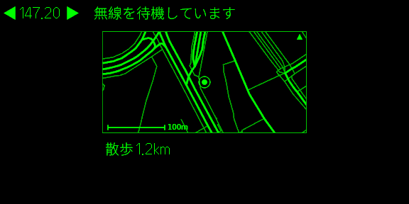
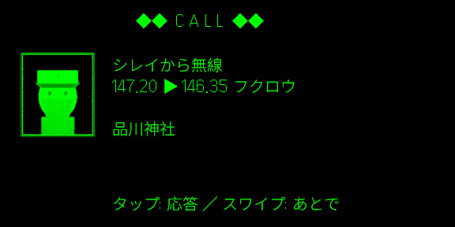
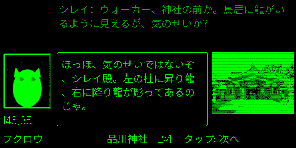
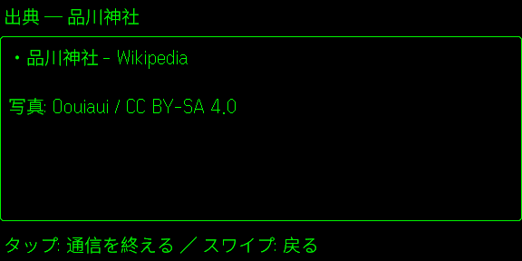

# CODEWALK for Even G2

[English](README.md)

CODEWALK を Even G2 で使うための Even Hub アプリです。近くの場所についての無線（着信・会話・出典）が、メガネに出ます。

このアプリは単体で動きます。場所探しも会話づくりもこのアプリの中で行うので、ほかのアプリは要りません（iPhone・Android とも）。

CODEWALK がどんなものか、使う前に知っておくこと（AI が作る会話、自分の Claude API キー、外に送るデータ）は、[トップの README](../README.ja.md) にあります。

## 使い方

### 必要なもの

- Even G2 と Even アプリ
- Claude の API キー（[console.anthropic.com](https://console.anthropic.com/) で発行。利用料はそのキーに課金されます）

### 初めて起動したとき

1. Even アプリの Even Hub から CODEWALK を開きます。
2. スマホ側の画面で言語（日本語 / English）を選びます。
3. 次の画面で、このアプリに必要なものの案内が出ます。
4. 「設定」タブを開いて、Claude の API キーを入れます。

### スマホ側の画面

Even アプリで CODEWALK を開くと出る画面です。一番上で言語を選べます。その下に3つのタブがあります。

- **散歩**: 散歩の開始・終了と、お知らせ（位置が取れないときなど）
- **無線ログ**: 「今日」「今週」「すべて」で切り替えます。1件をタップすると出典が開き、もう一度再生もできます。
- **設定**: API キー、コードネーム、テーマ、無線の頻度、地図のピン、メガネのミニマップ、保存データ

### メガネでの操作

| 画面 | タップ | スワイプ | ダブルタップ | リング長押し |
| --- | --- | --- | --- | --- |
| 待機 | — | — | 終了の確認 | 散歩の開始／終了 |
| 着信 | 応答 | あとで（無線ログに未再生で保存） | 終了の確認 | — |
| 会話 | 次のセリフ | 上: 前のセリフ／下: 次のセリフ | 終了の確認 | — |
| 出典 | 通信を終える | 会話に戻る | 終了の確認 | — |

補足:

- 着信に10秒応答しないと「あとで」になります。
- 長押しはリングからのときだけ、しかも待機中だけ効きます。会話中に誤って散歩を止めないためです。
- 散歩を始められないとき（API キーがない、位置が取れないなど）は、待機画面の1行目に理由が出ます。

### 画面

| 待機 | 着信 | 会話 | 出典 |
| --- | --- | --- | --- |
|  |  |  |  |

- **待機**
  - 周波数と状態の一文、時刻、散歩した距離が出ます。
  - 散歩中は、レーダー風のミニマップも出ます（北が上、約360m×180m、100m の縮尺付き）。地図には、道路・現在地・無線を聞いた場所が出ます。
  - まだ聞いていない場所は地図に出しません。歩く先を誘導しないためです。
  - ミニマップは「設定」で消せます。
- **着信**: 点滅する CALL の表示、呼び出している人の顔、周波数、場所の名前
- **会話**
  - いまのセリフは枠の中に出て、1つ前のセリフはその上に暗く出ます。
  - 話している人の顔と周波数が出ます。Wikimedia Commons に場所の写真があれば、それも出ます。
- **出典**: 会話の出典と、写真の作者・ライセンス

メガネは緑1色・フォント1種類なので、顔と写真はメガネの16段階の濃淡に変えて、無線らしいノイズをかけています。

### スマホの画面を消して歩くとき

Even アプリの設定の「バックグラウンドタスク」で、**「常時表示の通知」をオン**にしてください。

- オフのままだと、画面を消している間は Even アプリが位置を更新しないので、無線が入りません。
- 位置情報の「常に許可」と、電池の「制限なし」だけでは足りません。

## ソースからビルドする

Node.js（npm）と Dart SDK が要ります。Dart SDK は [Flutter](https://docs.flutter.dev/get-started/install) に付いてきます。メガネのアプリは、[`app/lib/`](../app/lib/) の会話づくりの本体を JavaScript に変換して使っています。

```bash
cd g2
npm install
npm test                 # テスト（vitest）
npm run core             # Dart の本体を public/codewalk_core.js に変換（build でも行う）
npm run build            # 本体の変換＋型チェック＋ビルド（dist/）
npm run pack             # ビルドして Even Hub 用のパッケージ（codewalk.ehpk）を作る
node scripts/release.mjs # 版を上げて（patch。minor / major も指定可）ビルド・パッケージまで
```

`dart` か `flutter` が PATH にないときは、`DART=/path/to/flutter/bin/dart` を付けて実行します。

### 自分の肖像でパッケージを作る

リポジトリの肖像は見本です。自分の肖像をコミットせずにパッケージに入れるには、次のようにします。

1. リポジトリの一番上の `private/portraits/` に、同じファイル名（`commander.png`、`owl.png` など。[キャラクターの肖像](../README.ja.md#キャラクターの肖像)を参照）で置きます。`private/` は `.gitignore` で対象外になっています。
2. `node scripts/release.mjs` を実行します。

パッケージを作る前に、`dist/` の見本をこれらで置き換え、どの肖像を使ったかを表示します。`public/characters/` のファイルは変えません。足りない肖像があると止まります。別のフォルダを使うときは `CODEWALK_PORTRAITS=<フォルダ>` を付けます。`npm run pack` では、いつも見本を使います。

### 実機で試す

開発中の版をメガネで試す手順:

1. `npm run dev` を実行します。
2. `npx evenhub qr --url http://<PCのIP>:5173` を実行します。
3. 出てきた QR コードを Even アプリで読み込みます。

この方法で入れた版は、WebView が裏に回ると止まります。

画面を消したときの動きを試すには、`codewalk.ehpk` を Even Hub の開発者ポータル（Private builds か Beta Testing）にアップロードします。そのあと Even アプリの「Even Hub → Me → Apps → Private builds」からインストールします。

### シミュレーターで試す

1. 偽の散歩を付けてビルドします。指定した地点から5秒ごとに北へ約5m歩き、初回の質問は出ません。

   ```bash
   VITE_CODEWALK_FAKE_POS=35.6197,139.7426 npm run build
   npx vite preview --port 5173
   ```

2. 別のターミナルで `npm run simulate`（Even Hub のシミュレーター）を実行します。Linux では WebKitGTK 4.1（`libwebkit2gtk-4.1-0`）が要ります。
3. ウィンドウのボタンかキーボードで、Up／Down／Click／Double Click を送ります。

`--automation-port 9898` を付けて起動すると、スクリプトからも操作できます。

- `curl -X POST 127.0.0.1:9898/api/input -d '{"action":"click"}'` でタップを送れます。
- `curl 127.0.0.1:9898/api/screenshot/glasses -o shot.png` でメガネの画面を保存できます。

シミュレーターではスマホ側の画面を使えないので、API キーを入れられず、無線も鳴りません。待機画面の確認に使います。

### 自分でビルドしたものを配るとき

- [util.dart](../app/lib/engine/util.dart) の `appContactEmail` に、自分の連絡先を入れてください。Nominatim の利用規約が、アプリに名乗ることを求めているためです。空のときは、利用者が設定で入れた連絡先を使います。
- `app.json` の `package_id` を変えてください。
- ストアの説明文に、地図データのクレジット「© OpenStreetMap contributors、© OpenMapTiles」を入れてください。
- プライバシーポリシーには、通信する先と送るものを書いてください。
  - 通信する先: Claude、Wikipedia / Wikidata / Wikimedia Commons、Overpass、Nominatim、Photon、OpenFreeMap
  - 送るもの: [design.md](../design.md) の「外部サービスと送るもの」を参照

## 中の構成

```
スマホ
└─ Even アプリ
    └─ CODEWALK（WebView）
        ├─ 会話づくりの本体（public/codewalk_core.js）→ Claude・Wikipedia・OpenStreetMap に直接
        └─ 位置と保存は Even Hub SDK ── BLE ──> Even G2
```

- `src/main.ts`: 状態をメガネに描き、メガネの操作を本体に伝えます。画面の配置は `src/render.ts` にあります（テスト付きの純粋な関数）。
- `src/local.ts`: 本体を動かし、位置を渡します。設定・会話のキャッシュ・無線ログは Even Hub SDK で保存します。
- `src/companion.ts`: スマホ側の画面です。
- キャラクターの画像は `public/characters/` に、キャラクター名のファイルで入っています（`src/photo.ts` の `PORTRAIT_FILES`）。自分の絵に替えるときは、[キャラクターの肖像](../README.ja.md#キャラクターの肖像)を見てください。

Even アプリの位置の連続取得は、始めた直後に1回しか届きません。そのため、5秒ごとに位置を問い合わせています。また、スマホの画面を消しても、このアプリには伝わりません（WebView は「表示中」のまま）。

### 実機でまだ確かめていないこと

- スマホの画面を消して歩いたときに、タイマーが動き続けるか。止まる場合は、その間は無線が鳴りません。
- 実機のフォントで、漢字・かながシミュレーターと同じように折り返されるか（シミュレーターでは1行約27文字）。
- 上下のスワイプが、SCROLL_TOP／SCROLL_BOTTOM のどちらとして届くか。
