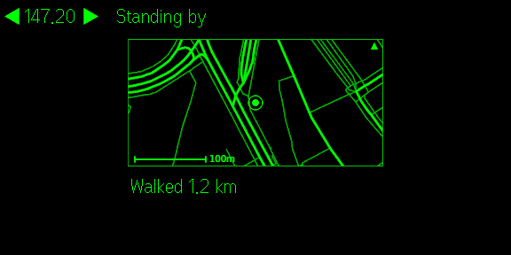
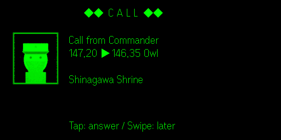
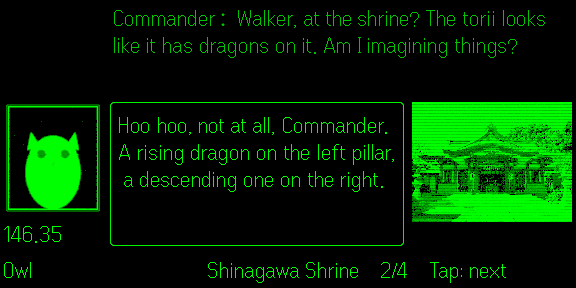
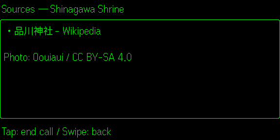

# CODEWALK for Even G2

[日本語](README.ja.md)

The Even Hub app that brings CODEWALK to Even G2 glasses: radio calls about places nearby, the conversation and its sources, right in front of you. It runs on its own: finding places and writing conversations happen inside this app, so no other app is needed, on iPhone or Android. On this branch (`phone-link`) it can also show the calls of the CODEWALK Android app running on the same phone (see [Linked to the Android app](#linked-to-the-android-app)).

For what CODEWALK is, and what you should know before using it (AI-generated content, your own Claude API key, the data sent out), see the [main README](../README.md).

## Using it

### What you need

- Even G2 glasses and the Even app
- A Claude API key ([console.anthropic.com](https://console.anthropic.com/)). Usage is billed to your key.

### First launch

1. Open CODEWALK from Even Hub in the Even app.
2. The phone page asks for your language (日本語 / English).
3. It then explains what the app needs.
4. Open the **Settings** tab and enter your Claude API key.

### The phone page

The phone page is shown in the Even app when you open CODEWALK. It has three tabs:

- **Walk**: start or end the walk, and any notices (such as a location problem).
- **Call log**: today / this week / all. Tap a call to see its sources, or play it again.
- **Settings**: API key, codename, topics, how often calls come, map pins, the minimap on the glasses, and saved data.

The language is chosen at the top of the page.

### On the glasses

| Screen | Tap | Swipe | Double tap | Long press on the ring |
| --- | --- | --- | --- | --- |
| Waiting | — | — | Exit prompt | Start / end the walk |
| Incoming call | Answer | Later (saved as unplayed in the call log) | Exit prompt | — |
| Conversation | Next line | Up: previous line / Down: next line | Exit prompt | — |
| Sources | End the call | Back to the conversation | Exit prompt | — |

Some details:

- An incoming call that you don't answer within 10 seconds is saved for later.
- The long press works only on the ring, and only while waiting, so a walk can't be ended by accident during a call.
- If the walk can't start (no API key, no location), the reason shows on the first line of the waiting screen.

### Screens

| Waiting | Incoming call | Conversation | Sources |
| --- | --- | --- | --- |
|  |  |  |  |

- **Waiting**:
  - The frequency and status line, the time, and the distance walked.
  - On a walk, a radar-style minimap: north up, about 360 m × 180 m, with a 100 m scale. It shows roads, your position, and the places where you heard calls.
  - Places you haven't heard yet are never shown: CODEWALK doesn't steer your walk.
  - You can turn the minimap off in Settings.
- **Incoming call**: the blinking CALL title, the caller's portrait, the frequencies and the place.
- **Conversation**:
  - The current line in a frame, with the previous line dimmed above it.
  - The speaker's portrait and frequency, and the place's photo from Wikimedia Commons when there is one.
- **Sources**: the sources of the conversation, and the photo's author and license.

The glasses show a single green colour and a single font, so portraits and photos are reduced to their 16 shades, with a bit of radio-style noise.

### Linked to the Android app

On this branch, the glasses app has three modes, chosen under the language at the top of the phone page (and on first launch):

| Mode | What happens |
| --- | --- |
| Auto (default) | Linked when the CODEWALK Android app runs on this phone, otherwise glasses only. Checked at launch and when the mode changes. |
| Linked | The Android app finds places, writes the conversations, and keeps the settings and the call log. The glasses app only shows its calls and sends your gestures back. |
| Glasses only | As described above. |

To link them:

1. In the Android app's Settings, turn on **Show radio calls on Even G2**. A **pairing code** (like `ABCD-EFGH`) shows under it.
2. Open CODEWALK in the Even app. While linked, the phone page shows the link status and a field for the code. Enter the code and tap **Connect**. Case and the hyphen don't matter. The code is remembered.

The link stays on the phone: the Android app answers only requests from the phone itself (`127.0.0.1`), and only those that carry the code. A web page open in the phone's browser therefore can't read your walk or send commands. After 30 wrong codes the Android app refuses everything for 5 minutes. To pair again from scratch, tap **New code** in its settings and enter the new code. Details: section 3.3 of [design.md](../design.md) (Japanese).

### Walking with the phone screen off

In the Even app's settings, under **Background tasks**, turn on the **persistent notification**. Without it, the Even app stops updating the location while the phone screen is off, and no calls come in. Allowing location "Always" and setting the battery to "Unrestricted" is not enough on its own.

## Building from source

You need Node.js (npm) and the Dart SDK. The Dart SDK comes with [Flutter](https://docs.flutter.dev/get-started/install). The glasses app runs the conversation engine from [`app/lib/`](../app/lib/), compiled to JavaScript.

```bash
cd g2
npm install
npm test                 # tests (vitest)
npm run core             # compile the Dart engine to public/codewalk_core.js (build does this too)
npm run build            # engine + type check + build (dist/)
npm run pack             # build and package for Even Hub (codewalk.ehpk)
node scripts/release.mjs # bump the version (patch; or minor / major), build and package
```

If `dart` or `flutter` is not on your PATH, run with `DART=/path/to/flutter/bin/dart`.

### Packaging with your own portraits

The repository's portraits are samples. To package your own without committing them:

1. Put them in `private/portraits/` at the top of the repository, with the same file names (`commander.png`, `owl.png`, …; see [Character portraits](../README.md#character-portraits)). `private/` is in `.gitignore`.
2. Run `node scripts/release.mjs`.

It replaces the samples in `dist/` with these before packing, and says which portraits it used. The files in `public/characters/` are not touched. If any portrait is missing, it stops. To use another folder, set `CODEWALK_PORTRAITS=<dir>`. `npm run pack` always uses the samples.

### On your glasses

To try a development build on your glasses:

1. Run `npm run dev`.
2. Run `npx evenhub qr --url http://<your PC's IP>:5173`.
3. Scan the QR code with the Even app.

A build loaded this way stops when the WebView goes to the background.

To test with the phone screen off, upload `codewalk.ehpk` to the Even Hub developer portal (Private builds or Beta Testing). Then install it in the Even app: Even Hub → Me → Apps → Private builds.

### In the simulator

1. Build with a fake walk. It starts at the given point and moves about 5 m north every 5 seconds, and it skips the first-launch questions:

   ```bash
   VITE_CODEWALK_FAKE_POS=35.6197,139.7426 npm run build
   npx vite preview --port 5173
   ```

2. In another terminal, run `npm run simulate` (the Even Hub simulator). On Linux it needs WebKitGTK 4.1 (`libwebkit2gtk-4.1-0`).
3. Send Up / Down / Click / Double Click from the window's buttons or the keyboard.

With `--automation-port 9898`, you can also control the simulator from a script:

- `curl -X POST 127.0.0.1:9898/api/input -d '{"action":"click"}'` sends a tap.
- `curl 127.0.0.1:9898/api/screenshot/glasses -o shot.png` saves the glasses screen.

The simulator can't use the phone page, so you can't enter an API key and no calls come in. It is for checking the waiting screen.

### Distributing your own build

- Set `appContactEmail` in [util.dart](../app/lib/engine/util.dart) to your contact address. Nominatim's usage policy asks apps to identify themselves. When it is empty, the user's own contact from Settings is used.
- Change `package_id` in `app.json`.
- Credit the map data in your store listing: "© OpenStreetMap contributors, © OpenMapTiles".
- In your privacy policy, list the services the app talks to and what it sends: Claude, Wikipedia / Wikidata / Wikimedia Commons, Overpass, Nominatim, Photon and OpenFreeMap. See section 8 of [design.md](../design.md).

## How it is put together

```
Phone
└─ Even app
    └─ CODEWALK (WebView)
        ├─ engine (public/codewalk_core.js) → Claude, Wikipedia, OpenStreetMap directly
        └─ location and storage through the Even Hub SDK ── BLE ──> Even G2
```

- `src/main.ts`: draws the state on the glasses and forwards the gestures. `src/render.ts` holds the screen layouts, as pure functions with tests.
- `src/local.ts`: runs the engine, feeds it the location, and stores settings, the conversation cache and the call log through the Even Hub SDK.
- `src/companion.ts`: the phone page.
- Character portraits ship in `public/characters/`, named after the characters (`PORTRAIT_FILES` in `src/photo.ts`). To use your own, see [Character portraits](../README.md#character-portraits).

The Even app's continuous location updates arrive only once after they start, so the app asks for a fix every 5 seconds. It also can't tell when the phone screen goes off: the WebView stays "visible".

### Not yet confirmed on real hardware

- Whether timers keep running while walking with the phone screen off. If they stop, no calls come in during that time.
- Whether Japanese text wraps on the glasses as it does in the simulator (about 27 characters per line).
- Which of SCROLL_TOP / SCROLL_BOTTOM a swipe up or down sends.
